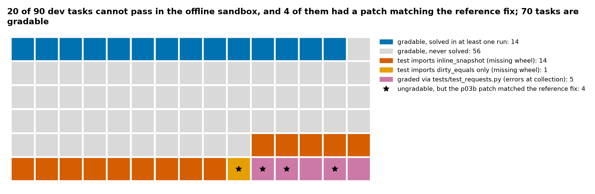
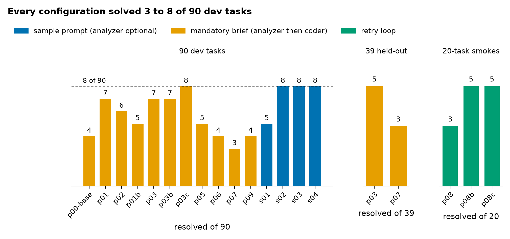
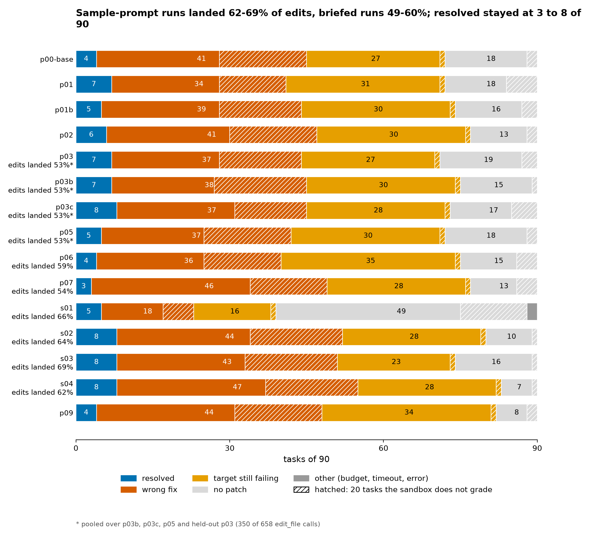
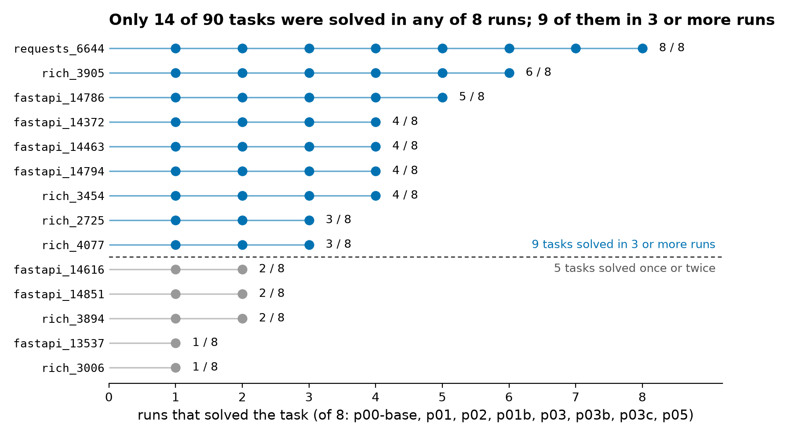
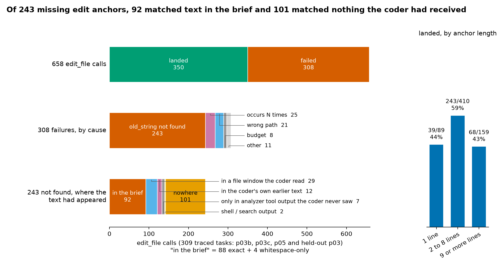

# No Test to Anchor On

*What 15 runs of a Gemma 4 E4B bug-fixing agent show about hidden tests, failed edits and run-to-run noise*

## Abstract

In 72 of our 90 development tasks the grading patch adds a new test function, and in 55 of 90 it touches no existing test; 1 report in 90 contains a traceback. A Gemma 4 E4B agent, offline in a 32,768-token window with about five minutes per SWE-bench-format task, has no failing test to run. Our best run solved 8 of 90; on the public leaderboard three submissions scored 0.06, 0.03 and 0.03 on 58 hidden tasks, which we read as 4, 2 and 2 (95% interval for 4 of 58, 1 to 10). Fifteen runs of 12 configurations all solved 3 to 8 of 90, and reruns of one configuration spanned 5 to 8, so no comparison of solve counts here is significant (largest gap 8 vs 3 of 90, Fisher p = 0.21). In 309 traced tasks, 243 of 308 failed edits asked to replace text not in the file.

The official sample prompt, run under our budget, was one of the 12 configurations and scored 8 of 90; our two-agent design, a read-only analyzer writing a brief for a coder, scored 7, 7 and 8. An edit lands when its anchor, the exact `old_string` the edit call must match, is in the file. Sample-prompt runs landed 62% to 69% of their edits (s02, with no edit rules, 64%; s03 69%; s04 62%); briefed runs landed 53% to 59% (350 of 658 over p03b, p03c, p05 and held-out p03; p06 59%; p07 54%). Edit rules added to either family moved its landing rate by about five points at most. Pooled over three runs each, 270 tasks a side, the sample family left fewer tasks with no patch (33 vs 51, p = 0.04), produced more wrong fixes (134 vs 112, p = 0.07) and resolved the same number (24 vs 22). Of 243 missing anchors in the four decoded briefed runs, 92 matched text in the brief and 101 matched nothing the coder had received. A landed edit is necessary and nowhere near sufficient: across the three sample-prompt runs, 213 of 237 applied patches still failed the graded test.

## 1. Introduction

Most writeups for this competition change a prompt, run once and report the new score. At a solve rate near 8% on 90 tasks, one run has a standard deviation of 2.5 tasks, so a three-task gain is not evidence of anything. This paper reports what 15 runs of Gemma 4 E4B, the smallest permitted model, show when read together.

The setting is the Gemma 4 Developer Agent competition: an agent declared only in YAML and Markdown prompts must fix real bugs in fastapi, rich, requests and httpx, offline, inside a 32,768-token window and about five minutes of agent time per task. We call a failing test or traceback the agent can run an execution anchor; we counted how often a task supplies one.

Contributions:

1. **The task condition, bounded and reproducible.** 72 of 90 development tasks add a new test function and 1 report of 90 contains a traceback; the counting rule is one sentence (Section 2) and `scripts/task_properties.py` applies it to any SWE-bench-format file.
2. **Landing versus outcome.** Of 658 `edit_file` calls in 309 traced tasks (p03b, p03c, p05, held-out p03), 308 failed, 243 because the anchor was not in the file; 92 of those matched the brief and 101 matched no text the coder had received (counts are per call). Sample-prompt runs landed 62% to 69% of edits against 53% to 59% for briefed runs, left fewer tasks with no patch (33 vs 51 of 270 pooled, p = 0.04) and resolved the same number (24 vs 22).
3. **A pre-stated negative result, with its breaches.** A mandatory, history-less brief as the coder's anchor source scored 7, 7 and 8 of 90 and did not beat the official sample prompt under the same budget (8 of 90; Fisher p = 1.0); leaderboard 4, 2 and 2 of 58 (Section 7).
4. **A noise data point for small agents.** SD 2.5 tasks at p about 0.08, n = 90; repeats of one configuration spanned 5 to 7 and 7 to 8; solve stability S = 1/13 over 5 runs, 2/14 over 3, 1/14 over 8; a local 8 versus 7 became a hidden 2 versus 4.

## 2. Setting

The agent works on the repository at the pre-fix commit with nine tools (shell, file read, edit, write, patch submission, a budget query, three code-graph tools). Its diff is applied to a fresh copy, the hidden test patch is added, and pytest decides; edits to tests are stripped first.

We split the 129 public tasks by repository into 90 development and 39 held-out tasks (seed 1234). Counting rule: a test patch "adds a new test function" when it contains a `+def test_` line and no `-def test_` line, and "touches no existing test" when every changed test line is an addition.

| Property of the 90 development tasks | Count |
| --- | --- |
| Test patch adds a new test function | 72 of 90 |
| Adds new tests and touches no existing test line | 55 of 90 |
| Also edits an existing test / creates a new test file | 17 / 0 of 90 |
| Report contains "Traceback" (any case: 5) | 1 of 90 |
| Report names an *Error or *Exception class | 10 of 90 |
| Reference fix touches one file / three or more | 65 / 13 of 90 |

At least 20 of the 90 development tasks are ungradable in the offline sandbox (14 import `inline_snapshot`, 1 `dirty_equals`, 5 grade through `tests/test_requests.py`, which errors at collection); none of the 20 was ever solved, the local denominator for rates is 70, and the host states that private scoring is unaffected [10].

*Figure 1. The 20 of 90 development tasks the offline sandbox never grades; none was ever solved.*

**Budget.** About 120 hidden tasks must finish inside a 12-hour wall that includes model start-up (366 s on our first run, 4 L4 GPUs) and grading. We set 5 minutes, 28 tool calls, 24 turns and a 150-second command timeout per task.

## 3. Method

Two Gemma 4 E4B instances split the work. The **analyzer** is a read-only sub-agent (shell, file read, code-graph tools) with 12 tool calls and no conversation history: it greps the package for identifiers in the report, writes and runs `/tmp/repro.py`, and answers with a seven-section **brief** whose `CODE` section quotes the code and whose `EDIT_SITES` section gives an exact `old_string` per site. The **coder** calls the analyzer once, applies the top edit with `edit_file`, re-runs the check, repairs at most twice, runs the module's tests and always submits. `include_contents: none` hides the conversation from the analyzer, including the repository layout given in the first user message.

Sampling: temperature 0.2, top_p 0.9, top_k 40, seed 7; 6,144 output tokens and a 2,048-token thinking budget from p03 on (8,192 and 3,072 before). The comparison is the official sample agent (`variants/sample-e4b`): its `agent.yaml` includes `code_analyzer` as an optional agent tool; its `sampling.yaml` reserves 16,384 output tokens.

## 4. Results

No configuration left the band of 3 to 8 solved tasks out of 90. p-runs are the two-agent design, s-runs the official sample prompt.

| Run | Change | Resolved of 90 |
| --- | --- | --- |
| p00-base | spec prompts, 8,192 / 3,072 tokens | 4 |
| p01, p01b | analyzer writes a repro; p01b is p01 unchanged | 7, 5 |
| p03, p03b, p03c | 6,144 / 2,048 tokens; three runs of the same configuration | 7, 7, 8 |
| p07 | anchors only from `read_file`, never resend a failed anchor | 3 |
| p09 | p07 plus a public prompt recipe | 4 |
| s01 | sample prompt, sample budget (1 min, 10 calls) | 5 |
| s02 | sample prompt, our budget (5 min, 28 calls) | 8 |
| s03, s04 | s02 plus edit rules; s04 adds a prompt recipe | 8, 8 |

*Figure 2. Resolved tasks for every full run (of 90), two held-out runs (of 39) and three 20-task smokes.*

On the public leaderboard of 58 hidden tasks p03 scored 0.06 and s01 and s04 0.03, read as 4 and 2 of 58. s02, s03 and s04 each scored 8 of 90 and the three p03 repeats 7, 7 and 8 (Fisher p = 1.0); p07's 3 against the pooled p03 repeats' 22 of 270 gives p = 0.15, unproven by the Section 5.1 rule. s03 and s04 carried a broken `split("\n")` example (a raw newline inside the quotes), so their edit rules were not exactly p07's.

Unresolved tasks fall into three buckets: wrong fix (patch applied, graded tests fail), target still failing (patch applied, other tests pass, graded test fails) and no patch (empty diff); Figure 3 gives the counts per run.

*Figure 3. The same three buckets in every run; landing labels are decode counts. The no-patch share moves between prompt families, the resolved share does not; hatched, the 20 tasks the sandbox does not grade.*

The one-minute sample budget (s01) left 49 of 90 tasks with no patch against 10 of 90 under our budget (s02; p = 5e-10) and resolved 5 against 8 (p = 0.57).

## 5. Analysis

### 5.1 The noise floor

At 7 solved of 90 (p about 0.08) the binomial standard deviation of one run is 2.5 tasks, so the 95% interval around one run spans about 5 tasks either way. Temperature 0.2 and a fixed seed do not remove the variance: four tasks share one vLLM instance.

Repeated configurations: p01 and p01b scored 7 and 5 and disagreed on 8 tasks (McNemar p = 0.73); the p03 trio scored 7, 7 and 8. Solve stability S, the tasks solved in every run over the tasks solved in any, was 1/13 over the first 5 runs, 2/14 over the 3 p03 repeats and 1/14 over 8 runs. Only 14 of 90 tasks were ever solved in 8 runs; the 3 p03 repeats alone reached all 14. Over all 15 full runs the union is 16 of 90; the sample-prompt runs added fastapi_9753 and rich_2943.

*Figure 4. Times solved per task across 8 two-agent runs: 14 of 90 ever solved, 9 in three or more runs, 1 in all eight.*

Rule: state a difference as two counts with a p-value, and treat anything inside the repeat spread (5 to 8 of 90) as unproven. The leaderboard applied it for us: local 8 (s04) versus 7 (p03) became hidden 2 versus 4 of 58.

### 5.2 Where edit anchors come from

`scripts/edit_decode.py` reads the traces of p03b, p03c, p05 and held-out p03 (309 tasks). The coder called `edit_file` 658 times: 350 landed, 308 failed, the failures being 243 "old_string not found", 25 "occurs N times", 21 wrong path, 8 budget and 11 other. For the 243 the script asks where the anchor text had appeared in what the coder had seen: 92 matched text in the brief (88 exactly, 4 up to whitespace), 29 a file window the coder had read, 12 the coder's own earlier text, 7 only analyzer output the coder never saw, 2 shell or search output, and 101 matched nothing the coder had received, exactly or up to spaces. The match is a plain substring (`read_file` output carries no line-number prefixes); file windows are tested before the brief, so 92 is a lower bound. Counts are per call: 45 of the 308 failures resent an anchor already rejected.

The brief's `CODE` section is the analyzer's paraphrase, and the design relies on it as the anchor source: 92 of 243 missing anchors matched it and 101 matched nothing the coder had received. The analyzer wrote 33 of 309 briefs without any tool call; 5 of those tasks resolved against 20 of the other 276 (p = 0.16), so a brief written without reading the code did not by itself cost resolutions. In the sample-prompt runs, which have no brief, most missing anchors matched nothing the agent had received (s02 40 of 51, s04 51 of 68; NOTES.md).

*Figure 5. The 658 edit calls of the four decoded briefed runs: failures by cause, the 243 missing anchors by what they matched, landing by anchor length (39 of 89, 243 of 410, 68 of 159).*

### 5.3 What landed edits became

Landing rates from the decode: briefed runs 53% (350 of 658 over p03b, p03c, p05 and held-out p03), 59% (p06, 118 of 199), 54% (p07, 93 of 172); sample-prompt runs 64% (s02, 119 of 187, no edit rules), 69% (s03, 117 of 169), 62% (s04, 149 of 239). The rules moved landing within a family by at most five points (p = 0.31, 0.84); the gap is between families (p = 6e-5). Pooled over three runs each: no-patch 33 vs 51 of 270 (p = 0.043), wrong fix 134 vs 112 (p = 0.069), resolved 24 vs 22 (p = 0.88); only the no-patch contrast clears the Section 5.1 rule, and p03 to s04 (19 to 7, 37 to 47) is the extreme single-run pair. Zha reports the same flat resolved count at 31B under three loop-breaking levers that changed behaviour (71, 73 and 72 of 218) [7].

### 5.4 The output reservation

Reserved output sets a hard prompt ceiling: 32,768 minus 8,192 is 24,576, and the run log shows the rejection at 24,577 input tokens. Counted in the run log, context-window overflows went from 12 of 90 tasks (p01b, 8,192 reserved) to 0 of 90 (p03, 6,144; p = 0.0003); turn-cap hits went 8 to 4 (p = 0.37, unproven) and timeouts stayed at 8. The official sample reserves 16,384 output tokens, a 16,384-token prompt ceiling.

## 6. What to do differently

1. **Repeat before you compare.** Run the unchanged configuration at least twice (our repeats spanned 5 to 7 and 7 to 8 of 90) and treat anything inside that spread as unproven.
2. **Reserve less output.** In a 32,768-token window, 6,144 reserved tokens removed all 12 overflows counted at 8,192.
3. **Count landed edits and wrong fixes together.** The design that landed more edits had fewer empty patches and more wrong fixes at the same resolved count; report landing rate and all three buckets per run, with denominators.

## 7. What we wrote down, and what happened

We committed the falsification clauses at 15:28 on 2026-11-05 (a0fa0c9), with the repeat runs described there as queued and none of their results in the paper; the results were committed 16 minutes later (3a223bb). The repository does not show whether the Kaggle output was visible to us before 15:28. The clauses said p03 repeats outside 5 to 7 would void the noise floor: the third repeat scored 8, one task outside, and the pooled spread of repeated configurations is 5 to 8. They said a traceback-anchored baseline matching reproduce-first over repeated runs would void the redesign: we ran the official sample prompt in four variants, none repeated; s02 scored 8 of 90 and matched, so the design claim rests on weaker evidence than we specified. They said overflow reappearing at 6,144 reserved tokens would mean the mechanism was incomplete: the p03b log shows none; p03c's limit events were not recorded.

## 8. Limitations

Ninety public tasks in three repositories, one to three runs per configuration, one model, one harness. The bucket contrast in Section 5.3 pools three single runs a side of two prompt families and does not separate the brief from the other prompt differences; the anchor decode counts calls, not distinct anchors, and does not judge whether a landed edit was the right edit. A 12-task probe of Gemma 4 12B at the 8,192 / 3,072 budget ended every task on a limit. Held-out 5 of 39 and leaderboard 4 of 58 are consistent with the development rate.

## 9. Related work

The format is SWE-bench's [1]. SWE-agent [2] showed that the tool interface shapes success; Agentless [3] made reproduction tests a ranking signal for strong models. "On Randomness in Agentic Evals" [4] reports single-run pass@1 moving 2.2 to 6.0 points between identical runs on SWE-bench Verified. Sweep [5] found 77% of `str_replace` failures were text not in the file; our 243 of 308 (79%) replicates that on E4B and adds the source split. Toeda's pre-registered study [6] (3 sizes, 2 scaffolds, 5 seeds) is the best-powered E4B result we know of. Gluzdov [8] reports E4B editing the wrong file in 13 of 31 tasks; Thakur [9] reports one 31B configuration scoring 55 then 48. New here is the count of the task condition itself: nobody we read counted whether the grading test pre-exists.

## 10. Reproducibility

Code, prompts, configs, the experiment log and per-task files are at [github.com/satyarthshukla500/hidden-test-agent-kit](https://github.com/satyarthshukla500/hidden-test-agent-kit) (MIT). Runs are versions of the Kaggle notebook [voidwalkers123/getting-started-gemma-4-developer-agent](https://www.kaggle.com/code/voidwalkers123/getting-started-gemma-4-developer-agent); the traces behind Section 5.2 are in the Kaggle dataset `voidwalkers123/gemma-agent-results-night2`. `results/<run>/edits.csv`, written by `edit_decode.py`, holds every decoded edit call (result and, for a missing anchor, where its text had appeared) for all 15 decoded runs, including every run whose landing count appears above. Scripts (Python 3.10, standard library; matplotlib for figures): `make_splits.py`, `task_properties.py`, `buckets.py`, `noise_floor.py`, `edit_decode.py`, `make_figures.py`. Per-task bucket files exist for every run in Figure 2, the held-out runs and the smokes included; notebook versions and commands, see EXPERIMENTS.md.

## References

1. C. E. Jimenez, J. Yang, A. Wettig, S. Yao, K. Pei, O. Press, K. Narasimhan. SWE-bench: Can Language Models Resolve Real-World GitHub Issues? ICLR 2024. https://arxiv.org/abs/2310.06770
2. J. Yang, C. E. Jimenez, A. Wettig, K. Lieret, S. Yao, K. Narasimhan, O. Press. SWE-agent: Agent-Computer Interfaces Enable Automated Software Engineering. NeurIPS 2024. https://arxiv.org/abs/2405.15793
3. C. S. Xia, Y. Deng, S. Dunn, L. Zhang. Agentless: Demystifying LLM-based Software Engineering Agents. arXiv:2407.01489, 2024. https://arxiv.org/abs/2407.01489
4. On Randomness in Agentic Evals. arXiv:2602.07150, 2026. https://arxiv.org/abs/2602.07150
5. Sweep. Lessons from building a coding agent for JetBrains. https://blog.sweep.dev/posts/jetbrains-coding-agent
6. T. Toeda. Scaffolding Helps the Smallest Gemma 4 Agent, Not the Larger Ones. Zenodo, 2026. https://zenodo.org/records/23834104
7. J. Zha. When Coding Agents Repeat: Persistence, Selection, and the Limits of Loop Breaking. 2026. https://github.com/usp787/Gemma4_paper_track
8. D. Gluzdov. 31B vs 12B vs E4B with the same agent files. Kaggle discussion, 2026. https://www.kaggle.com/competitions/gemma-4-developer-agent/discussion/750974
9. A. Thakur. Gemma 4 agent experiments: sampling, thinking, time limits, and tool ablations. Kaggle discussion, 2026. https://www.kaggle.com/competitions/gemma-4-developer-agent/discussion/746250
10. J. Wold. 27 fastapi tasks that fail at collection in the provided sandbox (host reply: private scoring excludes these tasks). Kaggle discussion, 2026. https://www.kaggle.com/competitions/gemma-4-developer-agent-paper/discussion/753370
