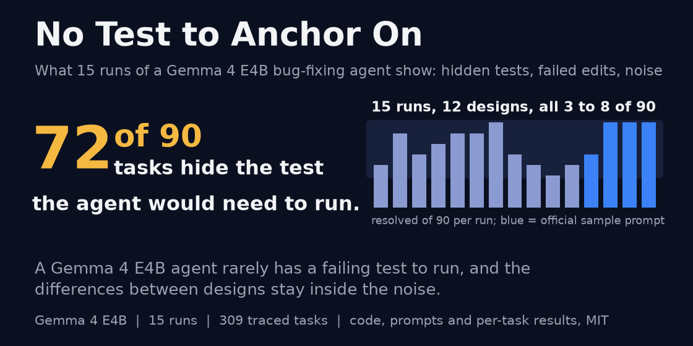

# hidden-test-agent-kit



Gemma 4 E4B is the smallest Gemma 4 model the competition allows; a task is one real bug report from fastapi, rich, requests or httpx that the agent must fix offline.

Finding, in one line: in 72 of 90 development tasks the grading patch adds a new test the agent never sees, so a Gemma 4 E4B agent has no failing test to run, and every one of our 15 runs solved 3 to 8 of 90; the rest is noise, measured. The paper is `PAPER.md`.

This repo holds the Gemma 4 E4B bug-fixing agents we ran in the Kaggle Gemma 4 Developer Agent competition (a reproduce-first analyzer-then-coder design in `submission/`, the official sample prompt under our budget and its variants, and a retry-loop design) and the small kit used to measure them. It goes with the paper "No Test to Anchor On" (`PAPER.md`). Public leaderboard (58 hidden tasks): p03 0.06, p08b 0.06, s01 0.03, s04 0.03, read as 4, 4, 2 and 2 tasks if the scores are truncated to two decimals.

**Run names.** `p*` runs other than `p08*` use the two-agent design (analyzer writes a brief, coder edits); `s*` runs use the official sample prompt; `p08*` are retry loops; `heldout-*` are the same configuration on the 39 held-out tasks; `*smoke` is a 20-task check. A letter suffix (p03b, p03c) is a repeat of the same configuration. An edit "lands" when its `old_string` is found in the file. The per-task outcome of every run is in `results/<tag>/buckets.json`; `wf / rg / np` in the logs are wrong fix, target test still failing, no patch.

Read next: `PAPER.md` for the findings, `EXPERIMENTS.md` for one row per run, `NOTES.md` for the running measurements.

The repository was first pushed on 2026-11-10; commit dates before that are local times.

## What is in it

- `submission/` the p03 agent as first submitted: `agent.yaml`, `sub_agents/code_analyzer.yaml`, prompts, sampling and budget config
- `prompts/reproduce_first.md` the analyzer prompt on its own
- `variants/` the other configurations (p00-base, p01 and p02 are earlier versions of `submission/` in the git history): `sample-e4b` (official sample prompt, s01), `sample-e4b-budget` (s02), `s03`, `s04`, `p06`, `p07`, `p09`, the retry loops `p08`, `p08b`, `p08c`, `rank2` (the analyzer ranks two edit sites, p05) and `12b-probe` (a 12B configuration prepared but not run; the 12-task 12B look, p01-12b, used p01's prompts)
- `scripts/` split, bucketing, noise floor, task properties, edit-anchor decode (`edit_decode.py`), figures (`make_figures.py`), build and Kaggle kernel generators
- `results/<tag>/buckets.json` per-task outcome of every run in the paper's tables; `results/<tag>/edits.csv` every `edit_file` call of the 15 decoded runs; five of them (p03b, p03c, p05, heldout-p03, p08csmoke) add an anchor hash and a resend flag and come with `tasks.csv` (analyzer tool calls, edit calls, landed, distinct anchors per task); `raw.txt` (four early runs) the compact line the notebook printed, task / bucket / tool calls, from which buckets.json was built; `brief_review.json` (p00-base) whether the analyzer's brief pointed at the file the reference fix touched
- `data/splits/` the dev and held-out task ids (the competition data itself is not redistributed)
- `figures/` the paper's figures, regenerated by `scripts/make_figures.py`

## Running it

Needs the competition files in `data/` (not redistributed). Python 3.10+, standard library only (matplotlib for the figures and the card).

```bash
python scripts/make_splits.py
python scripts/task_properties.py data/tasks.jsonl --split data/splits/dev.txt
python scripts/buckets.py p00-base p01 p02 p01b p03
python scripts/noise_floor.py --p 0.07 --n 90 --target 0.14
```

`make_splits.py` is seed 1234, 30% held out per repo, which gives 90 dev and 39 held-out.

To re-run a config, fork the official "Getting Started - Gemma 4 Developer Agent" notebook (it has the wheelhouse, models and L4 x4 attached), then

```bash
python scripts/build.py --model e4b
python scripts/make_kernel.py --user <kaggle-user> --tag p03 --split dev
```

and import the generated `kaggle/p03/gemma-agent-p03.ipynb` into the fork (`kaggle/` is generated, not committed). The log ends with a bucket table.

## Bucket labels

- `resolved` all required tests pass
- `wrong_fix` a patch was applied, the task was not resolved, and the test output does not show both passed and FAILED lines
- `regression` the patch applied and the test output has both passed and FAILED lines; in practice the graded test still fails while others pass, so the paper calls this bucket "target still failing"
- `no_patch` empty diff
- `apply_failed`, `timeout`, `budget_exhausted`, `agent_error` as named. Only `budget_exhausted` occurred: 2 tasks in s01 and 2 in the p08c smoke

## Notebook versions

Runs are versions of the Kaggle notebook `voidwalkers123/getting-started-gemma-4-developer-agent`. The scriptVersionId for each run is in `EXPERIMENTS.md`.

MIT license.
